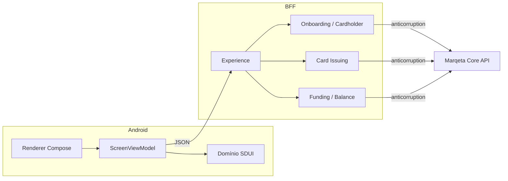
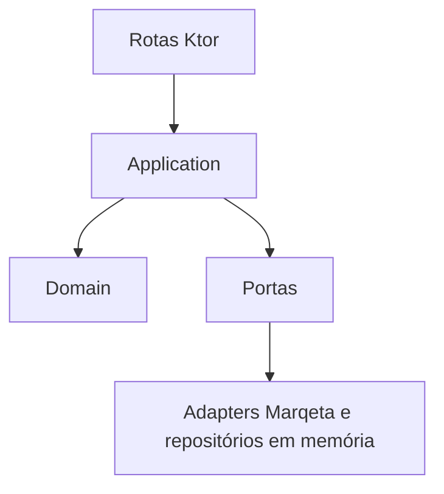

# Vereda

App Android nativo (Kotlin + Jetpack Compose) e um BFF em Ktor que reproduzem o fluxo de demonstração do [sproutify-web](https://github.com/marqeta/sproutify-web) contra o Public Sandbox da Marqeta (Core API, `https://sandbox-api.marqeta.com/v3`).

O código, o nome e a arte são próprios. O demo web não tem arquivo `LICENSE` (só `"license": "MIT"` no `package.json`, e o README diz que é só para demonstração), então nada de código, logo ou imagem foi copiado de lá.

## O que o fluxo faz

1. O app pede `GET /screens/bootstrap`. Sem sessão, o BFF devolve a tela de cadastro.
2. No cadastro, o BFF cria o cardholder (`POST /users`), emite o cartão no primeiro card product ativo (`GET /cardproducts`, `POST /cards`) e faz um GPA order de USD 100 com `funding_source_token` `sandbox_program_funding`.
3. A home chega como JSON. O componente `card` traz saldo (`gpa.available_balance`) e os últimos 4 dígitos. O app não guarda PAN.
4. Sair encerra a sessão. Entrar de novo confere e-mail e senha só no BFF.

A senha não existe na Marqeta nesse fluxo (o sign-in do demo web também é um stub). Ela fica hasheada no agregado Cardholder, em memória no BFF. Reiniciar o BFF esquece contas e sessões locais; os usuários criados no sandbox continuam lá, mas este app não consegue entrar de novo neles.

## Arquitetura

O app é server-driven: a única rota que ele conhece é `bootstrap`. Textos, validação e navegação vêm do schema. O ViewModel é event-driven (`UiState` em `StateFlow`, `UiEvent` num único `onEvent`, `UiEffect` num `Channel` para snackbar e navegação).

O domínio de negócio fica no BFF, em quatro bounded contexts. O módulo `contract` é a linguagem do contexto de Experience e, no Android, o domínio pequeno da UI (Screen, Component, Action), separado de Compose e de Retrofit.



| Contexto | Linguagem | Eventos |
| --- | --- | --- |
| Onboarding / Cardholder | Cardholder, Email, PersonName, Password, UserToken, SessionToken | — |
| Card Issuing | IssuedCard, CardLast4, CardToken, CardProductToken | CardIssued |
| Funding / Balance | Money, Currency, saldo disponível | AccountFunded |
| Experience / SDUI | Screen, Component, Action, Effect | CardholderRegistered na abertura da conta |

Cada contexto tem domínio (entidades, value objects, portas), aplicação (use cases) e infraestrutura. Os DTOs da Marqeta não saem de `infrastructure/marqeta`; os adapters traduzem para o modelo de domínio. O publisher de eventos é em processo, só para o demo.



## Schema das telas (versão 1)

`GET /screens/{id}` devolve:

```json
{
  "schemaVersion": 1,
  "id": "signup",
  "title": "Criar conta",
  "components": []
}
```

Componentes: `text`, `textField`, `button`, `card`, `list`, `spacer`. Tipo desconhecido vira fallback e mostra o próprio `type`, sem quebrar a tela. `schemaVersion` diferente de 1 é erro.

| Tipo | Campos |
| --- | --- |
| text | `id`, `value`, `style` (`title`, `body`, `caption`) |
| textField | `id`, `label`, `value`, `keyboard` (`text`, `email`, `password`, `number`), `validations` |
| button | `id`, `label`, `style` (`primary`, `text`), `action` |
| card | `id`, `holderName`, `lastFour`, `balanceLabel`, `balanceText` |
| list | `id`, `children` |
| spacer | `id`, `size` (`small`, `medium`, `large`) |

Ações do botão: `submit` (`endpoint` relativo, ex. `actions/signup`), `navigate` (`screenId`), `refresh` (`screenId`), `signOut` (`endpoint`). Ação desconhecida é ignorada.

Regras de campo: `required`, `email`, `minLength` (`min` + `message`). Regra desconhecida é ignorada no cliente; o BFF valida de novo.

`POST` de uma ação recebe `{ "fields": { "email": "..." } }` e responde:

```json
{
  "schemaVersion": 1,
  "fieldErrors": {},
  "effects": [
    { "type": "setSession", "token": "..." },
    { "type": "snackbar", "message": "Conta criada." },
    { "type": "showScreen", "screen": {} },
    { "type": "navigate", "screenId": "home" },
    { "type": "clearSession" }
  ]
}
```

Efeito desconhecido é ignorado. O app manda a sessão em `X-Session-Token`. `GET` sem sessão válida em tela protegida responde 401 com `clearSession` e `navigate` para `signup`.

O cartão na UI é um composable próprio, proporção ISO ID-1 (~1,586:1). O [UX Toolkit](https://www.marqeta.com/docs/developer-guides/uq-uxt-overview) da Marqeta não entra: ele pede programa de cliente, não funciona no public sandbox e não tem SDK Compose.

## Sandbox e chaves

1. Crie a conta pelo botão Public Sandbox, como no [quick start da Core API](https://www.marqeta.com/docs/developer-guides/core-api-quick-start). O formulário fica em [auth.marqeta.com/create-account](https://auth.marqeta.com/create-account). Depois de entrar, use Create sandbox e espere o e-mail de pronto.
2. Na aba API Keys do dashboard, copie o application token, o admin access token e a base URL. No quick start a base é `https://sandbox-api.marqeta.com/v3`; se a sua for outra, use `MARQETA_BASE_URL`.
3. Não coloque essas chaves no repositório. Elas dão acesso administrativo ao programa e não podem ir para o APK.

```bash
cp bff/local.properties.example bff/local.properties
# edite os placeholders, ou exporte:
export MARQETA_APPLICATION_TOKEN=...
export MARQETA_ADMIN_ACCESS_TOKEN=...
export MARQETA_BASE_URL=https://sandbox-api.marqeta.com/v3
```

Variável de ambiente ganha do arquivo. Também vale `bff/.env` no mesmo formato. `bff/local.properties`, `.env` e `local.properties` estão no `.gitignore`.

A URL do BFF no app sai de `bff.base.url` no `local.properties` da raiz (veja `local.properties.example`). O padrão `http://10.0.2.2:8080` é o host visto pelo emulador. Cleartext só é permitido para `10.0.2.2`, `localhost` e `127.0.0.1`.

## Como rodar

Pré-requisitos: JDK 21 e Android SDK (compileSdk 36).

```bash
./gradlew :bff:run
```

O BFF escuta em `0.0.0.0:8080` (`PORT` muda a porta). Sem as chaves ele não sobe. Em outro terminal:

```bash
./gradlew :app:installDebug
```

Testes, sem sandbox:

```bash
./gradlew :app:testDebugUnitTest :bff:test :contract:test
```

O cliente Marqeta e o cliente do app são exercitados com MockWebServer. Os use cases usam portas falsas. Não há chamada real ao sandbox neste repositório.

## Limitações

- O BFF guarda as chaves de admin e não autentica o chamador além do token de sessão opaco. Deixe-o só na máquina local.
- Contas, sessões e o hash da senha morrem quando o processo do BFF termina.
- O GPA order fixo de USD 100 usa o funding source `sandbox_program_funding` do public sandbox.
- O card product é o primeiro ativo devolvido por `GET /cardproducts`, não um token fixo.
- UX Toolkit da Marqeta não se aplica aqui.
- O demo web é só referência de fluxo. Este repositório não reutiliza o código dele.
