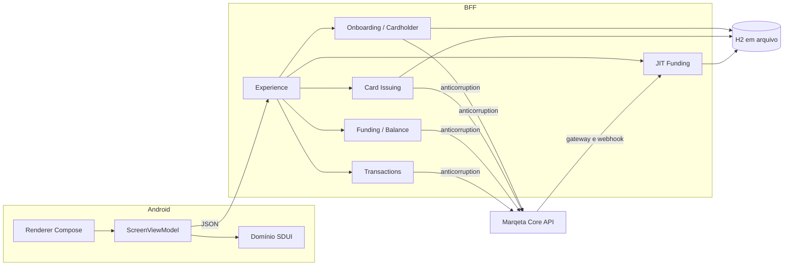
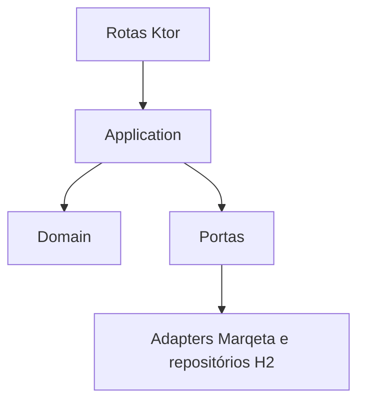

# Vereda

App Android nativo (Kotlin + Jetpack Compose) e um BFF em Ktor que reproduzem o fluxo de demonstração do [sproutify-web](https://github.com/marqeta/sproutify-web) contra o Public Sandbox da Marqeta (Core API, `https://sandbox-api.marqeta.com/v3`).

O código, o nome e a arte são próprios. O demo web não tem arquivo `LICENSE` (só `"license": "MIT"` no `package.json`, e o README diz que é só para demonstração), então nada de código, logo ou imagem foi copiado de lá.

## O que o fluxo faz

1. O app pede `GET /screens/bootstrap`. Sem sessão, o BFF devolve a tela de cadastro.
2. No cadastro, o BFF cria o cardholder (`POST /users`), emite o cartão no primeiro card product ativo (`GET /cardproducts`, `POST /cards`) e faz um GPA order de USD 100 com `funding_source_token` `sandbox_program_funding`.
3. A home chega como JSON. O componente `card` traz saldo (`gpa.available_balance`) e os últimos 4 dígitos. O app não guarda PAN.
4. "Transações" pede `GET /transactions?user_token=...` e a tela lista comércio, valor e estado.
5. "Simular compra" manda `POST /simulations/cardtransactions/authorization` (Simulations 2.0, o endpoint atual da doc para sandbox público e privado) e volta para a home, que relê o saldo. O use case publica `PurchaseSimulated`.
6. Puxar a tela para baixo repete o `GET` da tela atual. Os botões "Atualizar" fazem o mesmo via ação `refresh`.
7. "Bloquear cartão" / "Desbloquear cartão" chama `POST /cardtransitions` (`ACTIVE` ↔ `SUSPENDED`, canal `API`) e publica `CardStateChanged`. A home mostra o estado.
8. "Limite de gastos" grava um velocity control do usuário (`POST /velocitycontrols`, ou `PUT` se o token já existe) com `amount_limit`, `usage_limit` e janela `DAY`. Uma compra simulada que volta `DECLINED` acima desse valor aparece como recusa.
9. Sair encerra a sessão. Entrar de novo confere e-mail e senha só no BFF.

A senha não existe na Marqeta nesse fluxo (o sign-in do demo web também é um stub). Ela fica em bcrypt (custo 10) no agregado Cardholder. Cardholder, sessão e cartão (token e last4, nunca PAN) vão para um H2 em `bff/data/vereda` (gitignored; `VEREDA_DB_PATH` muda o arquivo). Reiniciar o BFF não apaga a conta local.

## Arquitetura

O app é server-driven: a única rota que ele conhece é `bootstrap`. Textos, validação e navegação vêm do schema. O ViewModel é event-driven (`UiState` em `StateFlow`, `UiEvent` num único `onEvent`, `UiEffect` num `Channel` para snackbar e navegação).

O domínio de negócio fica no BFF, em seis bounded contexts. O módulo `contract` é a linguagem do contexto de Experience e, no Android, o domínio pequeno da UI (Screen, Component, Action), separado de Compose e de Retrofit.



| Contexto | Linguagem | Eventos |
| --- | --- | --- |
| Onboarding / Cardholder | Cardholder, Email, PersonName, Password (bcrypt), UserToken, SessionToken | CardholderRegistered |
| Card Issuing | IssuedCard, CardLast4, CardToken, CardProductToken | CardIssued |
| Funding / Balance | Money, Currency, saldo disponível | AccountFunded |
| Transactions | CardTransaction, MerchantName | PurchaseSimulated |
| Spending | SpendLimit, SpendWindow | SpendLimitSet |
| JIT Funding | ledger, hold, decisão de funding | FundingApproved, FundingDeclined, HoldReleased, TransactionCleared |
| Experience / SDUI | Screen, Component, Action, Effect | monta as telas a partir dos outros contextos |

Cada contexto tem domínio (entidades, value objects, portas), aplicação (use cases) e infraestrutura. Os DTOs da Marqeta não saem de `infrastructure/marqeta`; os adapters traduzem para o modelo de domínio. O publisher de eventos é em processo, só para o demo.



## Schema das telas (versão 1)

`GET /screens/{id}` devolve:

```json
{
  "schemaVersion": 1,
  "id": "signup",
  "title": "Criar conta",
  "components": []
}
```

Componentes: `text`, `textField`, `button`, `card`, `list`, `spacer`. Tipo desconhecido vira fallback e mostra o próprio `type`, sem quebrar a tela. `schemaVersion` diferente de 1 é erro.

| Tipo | Campos |
| --- | --- |
| text | `id`, `value`, `style` (`title`, `body`, `caption`) |
| textField | `id`, `label`, `value`, `keyboard` (`text`, `email`, `password`, `number`), `validations` |
| button | `id`, `label`, `style` (`primary`, `text`), `action` |
| card | `id`, `holderName`, `lastFour`, `balanceLabel`, `balanceText` |
| list | `id`, `children` |
| spacer | `id`, `size` (`small`, `medium`, `large`) |

Ações do botão: `submit` (`endpoint` relativo, ex. `actions/signup`), `navigate` (`screenId`), `refresh` (`screenId`), `signOut` (`endpoint`). Ação desconhecida é ignorada.

Regras de campo: `required`, `email`, `minLength` (`min` + `message`), `money` (valor positivo com até 2 casas). Regra desconhecida é ignorada no cliente; o BFF valida de novo.

Telas além do cadastro: `signin`, `home`, `transactions`, `simulate-purchase`. O app não conhece esses ids; eles vêm nas ações. Puxar para baixo dispara o mesmo reload que a ação `refresh`.

Erros da Marqeta viram snackbar no BFF (pedido recusado, credencial, não encontrado, timeout, indisponível). O corpo da resposta não volta para o app. O cliente HTTP espera no máximo 5s para conectar e 15s pela resposta.

`POST` de uma ação recebe `{ "fields": { "email": "..." } }` e responde:

```json
{
  "schemaVersion": 1,
  "fieldErrors": {},
  "effects": [
    { "type": "setSession", "token": "..." },
    { "type": "snackbar", "message": "Conta criada." },
    { "type": "showScreen", "screen": {} },
    { "type": "navigate", "screenId": "home" },
    { "type": "clearSession" }
  ]
}
```

Efeito desconhecido é ignorado. O app manda a sessão em `X-Session-Token`. `GET` sem sessão válida em tela protegida responde 401 com `clearSession` e `navigate` para `signup`.

O cartão na UI é um composable próprio, proporção ISO ID-1 (~1,586:1). O [UX Toolkit](https://www.marqeta.com/docs/developer-guides/uq-uxt-overview) da Marqeta não entra: ele pede programa de cliente, não funciona no public sandbox e não tem SDK Compose.

## Painel de debug

No build debug do app há uma aba **Debug** embaixo da tela. Ela mostra as trocas `app → bff` (gravadas no aparelho) e `bff → marqeta` (lidas de `GET /debug/traces`). O app manda `X-Request-Id` em cada chamada e o BFF repete esse id nas chamadas à Marqeta, então as linhas da mesma ação ficam juntas. Dá para limpar e copiar o texto.

O buffer do BFF fica só em memória, as últimas 100 trocas de cada sessão, e não vai para log nem disco. `Authorization`, o token de sessão, senha, PAN, CVV, validade e os tokens de aplicação saem mascarados. `user_token` e `card_token` aparecem.

Ligado por padrão. Para desligar o endpoint (404), use `VEREDA_DEBUG_TRACES=false` no ambiente ou em `bff/local.properties`. O APK release não mostra o painel. No modo JIT o mesmo painel mostra também `marqeta → bff`: o pedido do gateway, a resposta 200 ou 402, a duração e o webhook. O `X-Request-Id` continua ligando app e BFF; o token JIT (ou `x-marqeta-request-trace-id`) liga o pedido da Marqeta ao webhook.

## JIT Gateway

O modo `jit` no cadastro emite o cartão num card product separado, com `jit_funding.programgateway_funding_source` e `refunds_destination` `GATEWAY`. Esse cartão não recebe o GPA order de USD 100. O saldo da home sai do ledger do BFF (também aberto em USD 100, só na base local). O modo `gpa` continua no primeiro card product ativo que não seja o produto JIT.

A Marqeta chama o BFF, não o contrário:

1. `POST /jit/gateway` é o pedido síncrono. O BFF responde 200, ecoando `jit_funding` (`token`, `method`, `user_token`, `amount` com duas casas), ou 402 com `decline_reason`: `INSUFFICIENT_FUNDS`, `CARD_NOT_ACTIVE` ou `AMOUNT_LIMIT_EXCEEDED`. Um balance inquiry devolve `balances` e não mexe no ledger. A resposta fica no processo local, bem abaixo do limite de 3 segundos. Recusa não altera o ledger.
2. Autorização aprovada abre um hold (`jit_funding.token`; incremental guarda `original_jit_funding_token`). O valor usado é `gpa_order.jit_funding.amount`.
3. `POST /jit/webhook` avisa o desfecho. Clearing baixa o hold e o ledger pelo `impacted_amount`. Reversal e timeout (`gateway_log.timed_out`) liberam o hold. Refund credita. A mesma chave `token` + `method` não aplica o efeito duas vezes, inclusive no retry do webhook.

Os dois endpoints exigem Basic Auth (`VEREDA_JIT_BASIC_USER` e `VEREDA_JIT_BASIC_PASSWORD`). A senha segue a regra da Marqeta: 20 a 50 caracteres, com maiúscula, minúscula, número e símbolo. A comparação é em tempo constante. Sem essa config o endpoint não existe (404).

O sandbox precisa de uma URL HTTPS pública. Suba o BFF, abra um túnel (por exemplo `ngrok http 8080`) e grave a origem em `VEREDA_PUBLIC_URL`.

```bash
export VEREDA_PUBLIC_URL=https://seu-tunel.example
export VEREDA_JIT_BASIC_USER=...
export VEREDA_JIT_BASIC_PASSWORD=...
./gradlew :bff:jitSandboxSetup
```

O comando cria ou atualiza `/fundingsources/programgateway`, o card product JIT e o webhook. Sem chaves, senha ou URL ele só avisa e termina com código 0. Não roda no CI. O relatório mostra as URLs e os tokens de recurso, nunca a senha nem as chaves de admin.

Com o BFF no ar atrás dessa URL, `./gradlew :bff:sandboxSmokeTest` também tenta o fluxo JIT: cadastro `jit`, simulação de compra e o estado devolvido pela Marqeta. Sem `VEREDA_PUBLIC_URL` essa parte é ignorada. O fluxo GPA do smoke continua no card product que não é o JIT.

## Sandbox e chaves

1. Crie a conta pelo botão Public Sandbox, como no [quick start da Core API](https://www.marqeta.com/docs/developer-guides/core-api-quick-start). O formulário fica em [auth.marqeta.com/create-account](https://auth.marqeta.com/create-account). Depois de entrar, use Create sandbox e espere o e-mail de pronto.
2. Na aba API Keys do dashboard, copie o application token, o admin access token e a base URL. No quick start a base é `https://sandbox-api.marqeta.com/v3`; se a sua for outra, use `MARQETA_BASE_URL`.
3. Não coloque essas chaves no repositório. Elas dão acesso administrativo ao programa e não podem ir para o APK.

```bash
cp bff/local.properties.example bff/local.properties
# edite os placeholders, ou exporte:
export MARQETA_APPLICATION_TOKEN=...
export MARQETA_ADMIN_ACCESS_TOKEN=...
export MARQETA_BASE_URL=https://sandbox-api.marqeta.com/v3
```

Variável de ambiente ganha do arquivo. Também vale `bff/.env` no mesmo formato. `bff/local.properties`, `.env` e `local.properties` estão no `.gitignore`.

A URL do BFF no app sai de `bff.base.url` no `local.properties` da raiz (veja `local.properties.example`). O padrão `http://10.0.2.2:8080` é o host visto pelo emulador. Cleartext só é permitido para `10.0.2.2`, `localhost` e `127.0.0.1`.

## Como rodar

Pré-requisitos: JDK 21 e Android SDK (compileSdk 36).

```bash
./gradlew :bff:run
```

O BFF escuta em `0.0.0.0:8080` (`PORT` muda a porta). Sem as chaves ele não sobe. Em outro terminal:

```bash
./gradlew :app:installDebug
```

Testes, sem sandbox:

```bash
./gradlew :app:testDebugUnitTest :bff:test :contract:test
```

Smoke test real, só na sua máquina, e só se as chaves estiverem no ambiente ou em `bff/local.properties`. Sem chaves ele termina com aviso e código 0. Não roda no CI. O relatório mostra last4, saldo, estado da compra e quantidade de transações, nunca os tokens:

```bash
./gradlew :bff:sandboxSmokeTest
```

O cliente Marqeta e o cliente do app são exercitados com MockWebServer. `AppAgainstBffTest` sobe o BFF de verdade contra esse fake. `SignupFlowTest` é um `androidTest` que abre o app contra um BFF falso na própria instrumentação. O CI obrigatório compila esse teste (`assembleDebugAndroidTest`) e não o executa. O workflow **Instrumented UI** é `workflow_dispatch`: emulador no GitHub Actions costuma estourar o tempo ou falhar no boot, então fica manual.

```bash
./gradlew :app:connectedDebugAndroidTest
```

Não há chamada automática ao sandbox. O smoke test acima é o caminho opcional para isso.

## Limitações

- O BFF guarda as chaves de admin e não autentica o chamador além do token de sessão opaco. Deixe-o só na máquina local.
- A doc de Simulations 2.0 descreve o endpoint de autorização para o sandbox público e o privado. O bloqueio usa `POST /cardtransitions` e o limite `POST /velocitycontrols` (com `PUT` se o controle já existe). Nenhum desses foi executado contra um sandbox real neste ambiente. O smoke test é o jeito de fazer isso localmente.
- O `androidTest` compila no CI e não foi executado num emulador aqui. O job de emulador é manual de propósito.
- O arquivo H2 fica na máquina que roda o BFF. Apagá-lo esquece a conta local; os usuários no sandbox continuam lá.
- O GPA order fixo de USD 100 usa o funding source `sandbox_program_funding` do public sandbox.
- O card product é o primeiro ativo devolvido por `GET /cardproducts`, não um token fixo.
- UX Toolkit da Marqeta não se aplica aqui.
- O demo web é só referência de fluxo. Este repositório não reutiliza o código dele.
