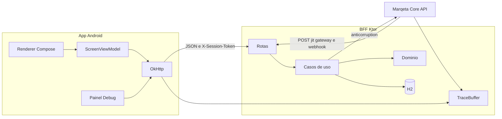
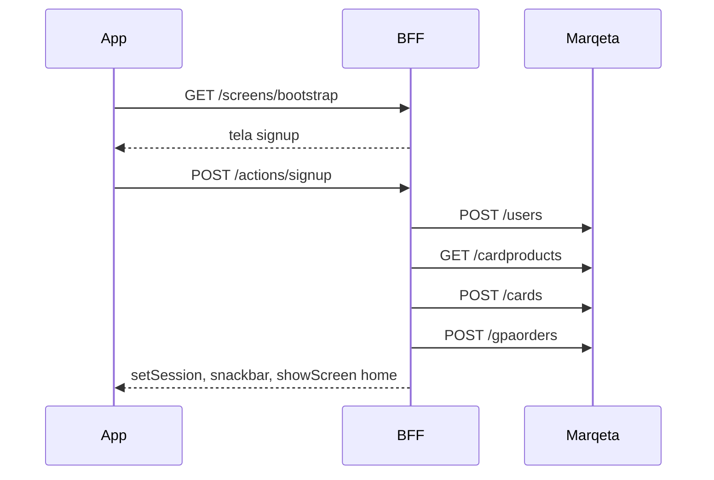
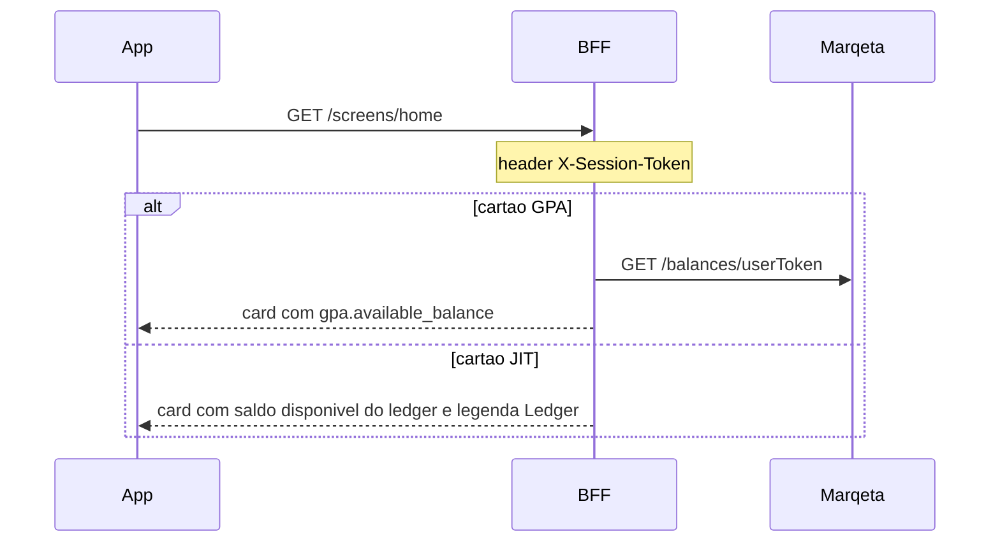
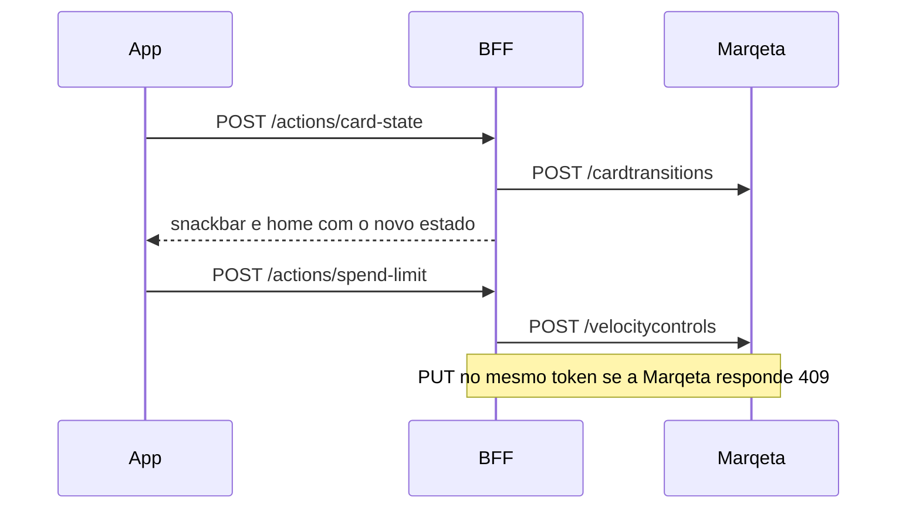
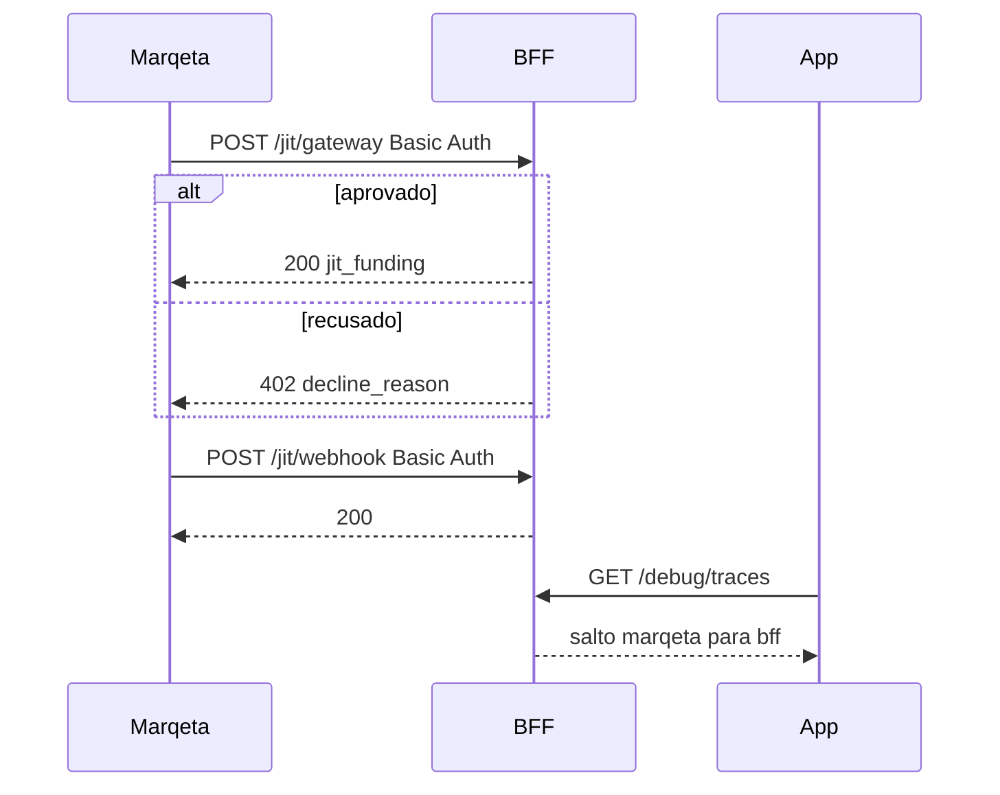
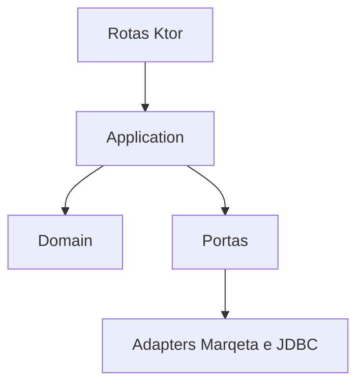

# Arquitetura da Vereda

Este texto descreve o que o repositório faz hoje. Os nomes de tipo, rota, tabela e variável são os do código. Onde o comportamento depende de configuração, o nome da variável aparece sem valor real.

A Vereda é um app Android de demonstração e um BFF em Ktor. O app não fala com a Marqeta. O BFF guarda as chaves de admin e traduz o Core API do Public Sandbox para telas JSON. O fluxo de cadastro com saldo pré-carregado segue a ideia do [sproutify-web](https://github.com/marqeta/sproutify-web). O JIT Gateway segue o contrato descrito pela Marqeta e pelo [reference-app](https://github.com/marqeta/reference-app) (MIT, arquivado): só o contrato e os fluxos, não o código Java.

Base padrão da Marqeta: `https://sandbox-api.marqeta.com/v3`, sobrescrita por `MARQETA_BASE_URL`.

## Visão dos componentes



O app só conhece a rota de tela `bootstrap`. As outras telas chegam em ações e efeitos. O painel de debug é nativo e só existe no build debug.

### Cadastro no modo gpa

`gpa` é o padrão (`VEREDA_CARD_FUNDING` ausente ou diferente de `JIT`). A senha não vai para a Marqeta.



O card product é o primeiro ativo cujo token não é o produto JIT reservado (`VEREDA_JIT_CARD_PRODUCT`, padrão `vereda_jit_card`). O GPA order usa `amount` `100.00`, `currency_code` `USD` e `funding_source_token` `sandbox_program_funding`. O BFF publica `CardholderRegistered`, `CardIssued` e `AccountFunded`.

### Home



Sem sessão válida numa tela protegida, a resposta é 401 com efeitos `clearSession` e `navigate` para `signup`. Puxar a tela ou a ação `refresh` repetem o `GET` da tela atual.

### Bloqueio e limite



`cardtransitions` manda `channel` `API`. Suspender usa `state` `SUSPENDED` e `reason_code` `01`. Desbloquear usa `ACTIVE` e `reason_code` `32`. O estado fica na coluna `issued_card.state`. O evento é `CardStateChanged`.

O limite diário grava `amount_limit`, `usage_limit`, `velocity_window` `DAY`, `currency_code` `USD` e `association.user_token`. O evento é `SpendLimitSet`. Na simulação, se a Marqeta devolve `DECLINED` e o valor pedido passa do limite guardado, o snackbar diz que a compra ficou acima do limite. Outra recusa vira "A Marqeta recusou a compra." Sucesso publica `PurchaseSimulated` e volta para a home.

### JIT: gateway e webhook

No cadastro, o campo `funding` aceita `gpa` ou `jit`. `jit` emite o cartão no produto dedicado (`issueOnProduct`) e abre o ledger local em USD 100.00. Não chama `POST /gpaorders`.



A Marqeta só alcança esses caminhos se o BFF estiver numa URL HTTPS pública. `jitSandboxSetup` grava essa URL na funding source e no webhook.

## App Android

Módulos Gradle (`settings.gradle.kts`): `:app`, `:bff`, `:contract`. O nome do projeto é `vereda`.

| Módulo | Papel |
| --- | --- |
| `:app` | Compose, Hilt, Retrofit. Pacote `app.vereda.mobile`. |
| `:contract` | Telas SDUI (`app.vereda.sdui`) e traces (`app.vereda.trace`). Sem Android. |
| `:bff` | Servidor Ktor. Pacote `app.vereda.bff`. |

`applicationId` `app.vereda.mobile`. `minSdk` 26, `compileSdk` 36, `targetSdk` 35. O app compila para JVM 17. O BFF e o contrato compilam para JVM 21. O CI usa JDK 21.

Pacotes do app: `ui` (renderer, `ScreenViewModel`, painel de debug), `data` (Retrofit, DataStore), `domain` (resultado de carga), `di` (Hilt), `debug` (interceptor e log em memória).

A navegação Compose tem um shell. Trocar de tela é um efeito, não uma rota nova por id de negócio.

### Contrato server-driven

`schemaVersion` é 1 (`SCHEMA_VERSION`). Versão diferente é erro no cliente. `ScreenJson` ignora campos desconhecidos, omite nulos e usa `type` como discriminador.

`GET /screens/{id}` devolve `Screen`: `schemaVersion`, `id`, `title`, `components`.

| `type` | Campos que o renderer usa |
| --- | --- |
| `text` | `id`, `value`, `style` (`title`, `body`, `caption`) |
| `textField` | `id`, `label`, `value`, `keyboard` (`text`, `email`, `password`, `number`), `validations` |
| `button` | `id`, `label`, `style` (`primary`, `text`), `action` |
| `card` | `id`, `holderName`, `lastFour`, `balanceLabel`, `balanceText` |
| `list` | `id`, `children` |
| `spacer` | `id`, `size` (`small`, `medium`, `large`) |

Tipo desconhecido vira `UnknownComponent` e a UI mostra o `type`. O cartão é um composable próprio, proporção ISO ID-1 (1,586). Não usa o UX Toolkit da Marqeta.

Telas que o BFF monta: `bootstrap`, `signup`, `signin`, `home`, `transactions`, `simulate-purchase`, `spend-limit`. O app só pede `bootstrap` sozinho. As outras vêm em `navigate` ou `showScreen`.

Ação de botão (`ComponentAction`):

| `type` | Efeito no app |
| --- | --- |
| `submit` | `POST` do `endpoint` com os campos |
| `navigate` | pede a tela `screenId` |
| `refresh` | recarrega `screenId` |
| `signOut` | `POST` do `endpoint` e limpa a sessão |
| outro | ignorada |

Regras de campo: `required`, `email`, `minLength` (`min` e `message`), `money` (positivo, no máximo 2 casas). Regra desconhecida é ignorada no cliente. O BFF valida de novo.

`POST` de ação manda `{ "fields": { ... } }` e recebe `ActionResponse`: `schemaVersion`, `fieldErrors`, `effects`.

| Efeito | Uso |
| --- | --- |
| `setSession` | grava o `token` opaco |
| `clearSession` | apaga o token |
| `showScreen` | troca a tela pelo `screen` embutido |
| `navigate` | carrega `screenId` |
| `snackbar` | mostra `message` |
| outro | ignorado |

### MVVM event-driven

`ScreenViewModel` expõe `ScreenUiState` num `StateFlow` e recebe um único `onEvent`.

Estados: `Loading`, `Content` (tela, campos, erros, `submitting`, `refreshing`), `Failed`.

Eventos: `Started`, `FieldChanged`, `ActionRequested`, `OpenScreen`, `Retry`, `Refresh`.

Efeitos, num `Channel`: `Snackbar`, `Navigate`.

`DebugViewModel` segue o mesmo desenho: estado com texto e painel aberto ou fechado; eventos `Toggle`, `Clear`, `Copy`; efeito `Copy` para a área de transferência. Não faz parte do schema de telas.

### Rede

Retrofit aponta para `BuildConfig.BFF_BASE_URL`. O valor sai de `bff.base.url` no `local.properties` da raiz. Se faltar, o padrão é `http://10.0.2.2:8080` (host do emulador). Cleartext só para `10.0.2.2`, `localhost` e `127.0.0.1`.

OkHttp, nesta ordem:

1. `SessionHeaderInterceptor` lê o token do DataStore `vereda_session`, chave `session_token`, e manda `X-Session-Token`. Há cache em memória.
2. No build debug, `AppTraceInterceptor` gera `X-Request-Id` se o pedido ainda não tiver um, grava método, URL, status, duração, headers e body já redatados, e não chama logcat. Pedidos a `debug/traces` não entram no log, para o painel não se registrar sozinho.

O cliente da Marqeta no BFF espera no máximo 5 s para conectar e 15 s pela resposta (`connectTimeoutMs`, `requestTimeoutMs`). Timeout vira `MarqetaCallFailed(408)`.

### Painel de debug e variantes

`debug` (`BuildConfig.DEBUG` verdadeiro): interceptor, `BffDebugSync` e aba Debug embaixo da tela. O texto é monoespaçado, rolável e selecionável. Botões Limpar e Copiar. A legenda lista os três saltos: `app → bff`, `bff → marqeta`, `marqeta → bff`.

Depois de cada ação, de um refresh e ao aplicar efeitos, o ViewModel chama `GET /debug/traces?since=`. A resposta junta as linhas do aparelho com as do BFF, sem duplicar a mesma identidade (`atMs`, hop, correlation id, método, alvo, status). Capacidade local: 100.

`release`: `isMinifyEnabled` é `false`. Não há interceptor de trace, o sync é `NoOpDebugTraceSync` e o painel não é composto. O APK release não mostra a aba.

O buffer do BFF também é memória, 100 trocas por chave de sessão. `VEREDA_DEBUG_TRACES=false`, `0` ou `off` (ambiente ou arquivo) não instala `GET /debug/traces`, que então responde 404. Ausente ou outro valor liga o buffer.

Nada de trace vai para disco nem para logcat. O redator (`TraceRedactor`) mascara header `Authorization`, `Proxy-Authorization`, `X-Session-Token`, `Cookie` e `Set-Cookie`. No JSON, mascara chaves como `password`, `pan`, `cvv`, `secret`, `authorization`, `application_token`, `admin_access_token`, `access_token`, `session_token`, `pin` e campos de validade. Também mascara sequências de 13 a 19 dígitos e o prefixo `Basic`. Chave `token` ou que termina em `_token` permanece, então `user_token` e `card_token` aparecem. O texto mascarado é `***`.

`X-Request-Id` nasce no app, o BFF o repete nas chamadas à Marqeta e o painel agrupa por esse id. No JIT, a chave de correlação é `original_jit_funding_token` ou, se não houver, `jit_funding.token`. O header `x-marqeta-request-trace-id` fica nos headers da linha.

## BFF Ktor

Entrada: `app.vereda.bff.ApplicationKt`. Netty em `0.0.0.0`. Porta `PORT` ou 8080. O grafo de produção é `BffGraph.create`.



Bounded contexts: Onboarding / Cardholder, Card Issuing, Funding / Balance, Transactions, Spending, JIT Funding, Experience / SDUI. DTOs da Marqeta ficam em `infrastructure/marqeta`. Os eventos de domínio são publicados em processo (`LoggingEventPublisher` só registra o nome da classe).

| Contexto | Tipos | Eventos |
| --- | --- | --- |
| Onboarding | `Cardholder`, `Email`, `PersonName`, `Password`, `UserToken`, `SessionToken` | `CardholderRegistered` |
| Card Issuing | `IssuedCard`, `CardLast4`, `CardToken`, `CardProductToken`, `CardState` | `CardIssued`, `CardStateChanged` |
| Funding | `Money`, `Currency` | `AccountFunded` |
| Transactions | `CardTransaction`, `MerchantName` | `PurchaseSimulated` |
| Spending | `SpendLimit`, `SpendWindow` | `SpendLimitSet` |
| JIT Funding | ledger, hold, `FundingMessage` | `FundingApproved`, `FundingDeclined`, `HoldReleased`, `TransactionCleared` |
| Experience | `Screen`, `Component`, `Action` | monta as telas |

`Money` exige escala 2 e valor não negativo. Moeda do demo: `USD`.

### Endpoints do BFF

| Método e caminho | Quem chama | Corpo / resposta |
| --- | --- | --- |
| `GET /health` | operador | `{ "status": "ok", "service": "..." }` |
| `GET /screens/{id}` | app, header `X-Session-Token` opcional | `Screen` ou 401 / 404 |
| `GET /debug/traces?since=` | app debug, sessão obrigatória | `TracePage` ou 401. Sem buffer, a rota não existe (404) |
| `POST /jit/gateway` | Marqeta, Basic Auth | 200 ou 402 com `jit_funding`. Sem credencial JIT válida, a rota não existe |
| `POST /jit/webhook` | Marqeta, Basic Auth | 200 e `{}` |
| `POST /actions/signup` | app | `ActionRequest` → `ActionResponse` |
| `POST /actions/signin` | app | igual |
| `POST /actions/signout` | app | efeitos de sessão limpa |
| `POST /actions/card-state` | app | exige sessão |
| `POST /actions/spend-limit` | app | campos `amount` e `usage` |
| `POST /actions/simulate-purchase` | app | campos `amount` e comércio |

`StatusPages`: `SessionRequired` → 401 com `clearSession` e `navigate` signup. `UnknownScreen` → 404 "Tela desconhecida." Qualquer outra exceção → 500 "Falha interna." e um log do erro, sem corpo da Marqeta.

Erros da Marqeta que os casos de uso traduzem para snackbar (`screenMessage`): 400, 402, 409 e 422 recusam o pedido; 401 e 403 são credencial do sandbox; 404 é recurso não encontrado; 408 é timeout; 5xx é indisponível. O corpo da Marqeta não volta para o app.

### Sessão

`SessionToken` é um UUID opaco. A tabela `app_session` liga o token ao `cardholder_id`. Sign-in confere e-mail e senha só contra o hash bcrypt local (custo 10, prefixo `$2`). A Marqeta não recebe a senha. Sign-out apaga a linha.

### H2

Arquivo padrão `bff/data/vereda` (`VEREDA_DB_PATH` troca o caminho). URL `jdbc:h2:file:...;DB_CLOSE_ON_EXIT=FALSE`, usuário `sa`, senha vazia. O diretório `bff/data/` e os arquivos `*.mv.db` / `*.trace.db` estão no `.gitignore`. Uma conexão sincronizada; escrita faz commit ou rollback.

| Tabela | Colunas |
| --- | --- |
| `cardholder` | `id` PK, `first_name`, `last_name`, `email` único, `password_hash`, `user_token` |
| `issued_card` | `cardholder_id` PK, `token`, `last_four` CHAR(4), `product_token`, `state` (`ACTIVE` padrão), `funding_mode` (`GPA` ou `JIT`) |
| `spend_limit` | `cardholder_id` PK, `control_token`, `amount_limit`, `usage_limit`, `velocity_window` |
| `app_session` | `token` PK, `cardholder_id` |
| `jit_account` | `user_token` PK, `ledger_balance`, `available_balance` (texto com 2 casas) |
| `jit_hold` | `token` PK, `user_token`, `original_token`, `amount`, `remaining`, `state`, `created_at` |
| `jit_seen` | PK (`channel`, `token`, `method`), `outcome` |

Não há coluna de PAN. `last_four` são 4 dígitos.

### Ledger JIT

`ledger` é o saldo liquidado. `available` é o ledger menos a soma dos holds `OPEN`. Os dois começam em 100.00 no `open` do cadastro JIT. Se a conta já existe, `open` não zera o saldo.

Autorização aprovada cria um hold do valor de `gpa_order.jit_funding.amount` (ou `gpa_order_unload`, se for o objeto presente). O ledger não muda. O disponível cai. Incremental grava `original_jit_funding_token` no hold novo; o valor se soma, não substitui.

Clearing (`pgfs.authorization.capture`, `pgfs.force_capture`, `pgfs.auth_plus_capture`) baixa os holds da família (token ou `original_token`) e o ledger pelo módulo de `impacted_amount`, ou pelo `amount` do JIT se o impacto não vier. Hold zerado fica `CLEARED`.

Reversal (`pgfs.authorization.reversal`, `pgfs.auth_plus_capture.reversal`) e timeout (`gpa_order.funding.gateway_log.timed_out` verdadeiro) liberam o hold (`RELEASED`) e devolvem o disponível. O ledger não muda. Refund (`pgfs.refund`, `pgfs.refund.authorization`) soma o valor ao ledger e ao disponível. Esse crédito não publica um evento próprio.

Idempotência: `jit_seen` guarda o canal (`gateway` ou `webhook`) mais `jit_funding.token` e `method`. Repetir o gateway devolve a mesma decisão sem outro hold. Repetir o webhook não aplica o efeito de novo. Canal separado importa: o webhook de timeout pode usar o mesmo token e method da autorização já aprovada no gateway e ainda assim liberar o hold.

A resposta 200 ecoa `token`, `method`, `user_token` e, quando há valor, `amount` como número JSON com duas casas (`10.00`, não string). Se o pedido trouxe `original_jit_funding_token`, a resposta o repete. A 402 acrescenta `decline_reason` e não altera o ledger. Balance inquiry (`pgfs.balanceinquiry`) responde 200 com `balances.USD` (`currency_code`, `ledger_balance`, `available_balance`, `pending_credits`) e sem campo `amount`, mesmo se o cartão estiver suspenso.

Ordem da decisão numa autorização (`pgfs.authorization`, `pgfs.authorization.incremental`, `pgfs.auth_plus_capture`):

1. Cartão do `user_token` que não está `ACTIVE` → `CARD_NOT_ACTIVE`.
2. Soma dos holds do dia UTC que não estão `RELEASED`, mais o pedido, acima do `amount_limit` diário guardado → `AMOUNT_LIMIT_EXCEEDED`. Sem limite gravado, essa regra não entra. O `usage_limit` não gera recusa no gateway.
3. Pedido maior que o disponível → `INSUFFICIENT_FUNDS`.
4. Valor ausente ou negativo → `INVALID_AMOUNT`.

`pgfs.authorization.account_verification`, `pgfs.refund.authorization` e `pgfs.original.credit.authorization` aprovam sem hold se o cartão está ativo; senão `CARD_NOT_ACTIVE`. Outro method no gateway recusa com `TRANSACTION_NOT_PERMITTED`. Webhook de method desconhecido fica `IGNORED` e responde 200.

O caminho do gateway não chama a Marqeta. A decisão é H2 local, para ficar abaixo do limite de 3 s do lado da Marqeta. Basic Auth inválido ou ausente responde 401 `{"error":"Não autorizado."}` e não mexe no ledger. A comparação faz SHA-256 dos dois lados e `MessageDigest.isEqual`. A senha precisa ter 20 a 50 caracteres, maiúscula, minúscula, número e um símbolo do conjunto aceito pela Marqeta. Fora disso, as credenciais são tratadas como ausentes e as rotas JIT não sobem.

### Configuração

Ambiente ganha de `bff/local.properties` e de `bff/.env`. Esses arquivos e o `local.properties` da raiz estão no `.gitignore`. O exemplo versionado é `bff/local.properties.example`, só com placeholders.

| Variável | Efeito |
| --- | --- |
| `MARQETA_APPLICATION_TOKEN` | usuário do Basic Auth da Marqeta. Obrigatória para o BFF subir |
| `MARQETA_ADMIN_ACCESS_TOKEN` | senha desse Basic Auth. Obrigatória para o BFF subir |
| `MARQETA_BASE_URL` | base do Core API. Padrão o sandbox público `/v3` |
| `PORT` | porta do BFF. Padrão 8080 |
| `VEREDA_DB_PATH` | arquivo H2 |
| `VEREDA_DEBUG_TRACES` | `false`, `0` ou `off` desliga o buffer |
| `VEREDA_CARD_FUNDING` | `JIT` ou, no resto, `GPA` |
| `VEREDA_JIT_CARD_PRODUCT` | token do card product JIT. Padrão `vereda_jit_card` |
| `VEREDA_JIT_FUNDING_SOURCE` | token da program gateway. Padrão `vereda_jit_gateway` |
| `VEREDA_JIT_WEBHOOK` | token do webhook. Padrão `vereda_jit_webhook` |
| `VEREDA_JIT_BASIC_USER` | usuário que a Marqeta usa ao chamar o BFF |
| `VEREDA_JIT_BASIC_PASSWORD` | senha desse Basic Auth, na regra de 20 a 50 caracteres |
| `VEREDA_PUBLIC_URL` | origem HTTPS do BFF, sem path. O setup acrescenta `/jit/gateway` e `/jit/webhook` |
| `VEREDA_BFF_URL` | só no smoke JIT. Padrão `http://127.0.0.1:8080` |
| `bff.base.url` | no `local.properties` da raiz, URL que o app embute |

## Integração Marqeta

O BFF depende do Core API do Public Sandbox. Autenticação de saída: HTTP Basic, usuário = application token, senha = admin access token. Essas chaves não entram no APK nem no Git.

Documentação usada pelo contrato:

- [Core API quick start](https://www.marqeta.com/docs/developer-guides/core-api-quick-start)
- [About Just-in-Time Funding](https://www.marqeta.com/docs/developer-guides/about-jit-funding)
- [Gateway JIT Funding Messages](https://www.marqeta.com/docs/core-api/gateway-jit-funding-messages)
- [Configuring Gateway JIT Funding](https://www.marqeta.com/docs/developer-guides/configuring-gateway-jit-funding)
- [Managing Timeouts](https://www.marqeta.com/docs/developer-guides/managing-timeouts)
- [Ledger Management with JIT Funding](https://www.marqeta.com/docs/developer-guides/ledger-management-with-jit-funding)
- [Create program gateway source](https://www.marqeta.com/docs/core-api/program-gateway-funding-sources/create-program-gateway-source)

### Endpoints que o código chama

Todos relativos à base `/v3`.

| Chamada | Quando |
| --- | --- |
| `POST /users` | cadastro. Corpo: `first_name`, `last_name`, `email`, `active` true. Sem senha |
| `GET /cardproducts?count=25` | achar o primeiro produto ativo que não seja o JIT |
| `POST /cards` | `user_token` e `card_product_token`. Guarda `token` e `last_four` |
| `POST /gpaorders` | só no modo gpa. USD 100.00 e `sandbox_program_funding` |
| `GET /balances/{userToken}` | home gpa. Lê `gpa.available_balance` |
| `GET /transactions` | `user_token`, `count` 25, `sort_by` `-created_time` |
| `POST /simulations/cardtransactions/authorization` | simulação. `card_token`, `amount`, `card_acceptor.mid` `11111` e `name` |
| `POST /cardtransitions` | bloqueio e desbloqueio, canal `API` |
| `POST /velocitycontrols` | limite novo |
| `PUT /velocitycontrols/{token}` | o mesmo limite quando o POST volta 409 |
| `GET` ou `POST` ou `PUT /fundingsources/programgateway` | só `jitSandboxSetup` |
| `GET` ou `POST` ou `PUT /cardproducts` | só o setup, produto JIT |
| `GET` ou `POST` ou `PUT /webhooks` | só o setup |

O produto JIT pede `config.jit_funding.programgateway_funding_source` com `enabled` true, `funding_source_token` e `refunds_destination` `GATEWAY`. A funding source manda `url` HTTPS do gateway, `basic_auth_username`, `basic_auth_password` e `active` true. O webhook escuta `events` `["*"]` na URL `/jit/webhook`, com o mesmo Basic Auth. O setup não imprime a senha nem o corpo devolvido pela Marqeta.

`./gradlew :bff:jitSandboxSetup` cria ou atualiza esses três recursos. Sem chaves da Marqeta, sem usuário/senha JIT válidos ou sem `VEREDA_PUBLIC_URL` começando por `https://`, imprime o motivo e termina com código 0. Não entra no CI.

`./gradlew :bff:sandboxSmokeTest` faz o fluxo gpa no sandbox se as chaves existem. Sem chaves, avisa e sai 0. Se a URL pública e a senha JIT existem, também tenta cadastro `jit` contra o BFF local e uma simulação. Se o BFF não está no ar, essa parte é ignorada. Não entra no CI. O relatório mostra last4 e estado, não os tokens de admin.

Limites deste demo no sandbox: não há chamada automática no CI; o GPA de USD 100 usa o funding source de sandbox `sandbox_program_funding`; o produto gpa não é um token fixo; o JIT precisa de túnel HTTPS porque a Marqeta recusa URL que não seja HTTPS; o timeout de gateway da Marqeta é 3 s (o nosso caminho local não espera a rede). A conta do sandbox se cria pelo fluxo do quick start, em [auth.marqeta.com/create-account](https://auth.marqeta.com/create-account).

## Dependências

Lidas de `gradle/libs.versions.toml` e do wrapper `gradle-8.13`.

| Peça | Versão |
| --- | --- |
| Android Gradle Plugin | 8.13.2 |
| Kotlin | 2.2.21 |
| KSP | 2.2.21-2.0.5 |
| Compose BOM | 2026.01.01 |
| Navigation Compose | 2.9.5 |
| Activity Compose | 1.11.0 |
| Lifecycle | 2.9.4 |
| Core KTX | 1.16.0 |
| Hilt | 2.56.2 |
| Hilt Navigation Compose | 1.2.0 |
| Coroutines | 1.10.2 |
| kotlinx.serialization | 1.9.0 |
| Retrofit | 2.11.0 |
| Conversor Retrofit de Jake Wharton | 1.0.0 |
| OkHttp e MockWebServer | 4.12.0 |
| DataStore | 1.1.7 |
| Ktor | 3.1.3 |
| Logback | 1.5.18 |
| bcrypt (`at.favre.lib`) | 0.10.2 |
| H2 | 2.3.232 |
| JUnit | 4.13.2 |
| Robolectric | 4.14.1 |
| MockK | 1.14.2 |
| Turbine | 1.2.1 |
| AndroidX JUnit | 1.2.1 |
| Espresso | 3.6.1 |

## Testes e CI

Unidade, sem sandbox:

```bash
./gradlew :app:testDebugUnitTest :bff:test :contract:test
```

O CI (`.github/workflows/ci.yml`), em push e pull request, instala o Android SDK (platform 36 e build-tools 35.0.0) e roda:

```bash
./gradlew :app:testDebugUnitTest :app:assembleDebug :app:assembleDebugAndroidTest :bff:test :contract:test --stacktrace
```

| Suíte | O que cobre |
| --- | --- |
| `:contract:test` | regras de campo e o redator de traces |
| `:bff:test` | rotas com Ktor test host, cliente Marqeta com MockWebServer, H2, ledger, gateway JIT (aprovação, as três recusas, idempotência, clearing, reversal, timeout, refund, 401) |
| `:app:testDebugUnitTest` | ViewModel, renderer, cartão, interceptor de debug. Robolectric, MockK, Turbine |
| `AppAgainstBffTest` | JVM: BFF Ktor de verdade contra MockWebServer e o cliente HTTP do app |
| `SignupFlowTest` (`androidTest`) | app contra um BFF falso na instrumentação. O CI só compila (`assembleDebugAndroidTest`) |
| Instrumented UI | `.github/workflows/android-instrumented.yml`, só `workflow_dispatch`, emulador API 34, `connectedDebugAndroidTest` |
| `:bff:sandboxSmokeTest` e `:bff:jitSandboxSetup` | opt-in local. Fora do CI |

## Segurança

Não há credencial real no repositório. Os exemplos usam placeholders. `local.properties`, `bff/local.properties`, `bff/.env` e o arquivo H2 ficam de fora do Git.

O que o painel e o redator escondem: `Authorization` (Basic da Marqeta e qualquer outro), token de sessão, senha, PAN e sequências de 13 a 19 dígitos, CVV, validade, application token, admin access token e chaves com `password`, `secret`, `cvv`, `pin` ou `expir`. `user_token` e `card_token` podem aparecer. O 401 do gateway não devolve a senha. O setup e o smoke não imprimem senha nem token de admin.

O BFF não autentica o app além do token de sessão opaco. Deve ficar na máquina local. A senha do cardholder é bcrypt e não sai para a Marqeta nem para o trace.
